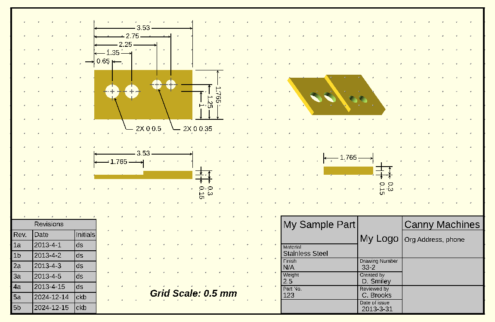
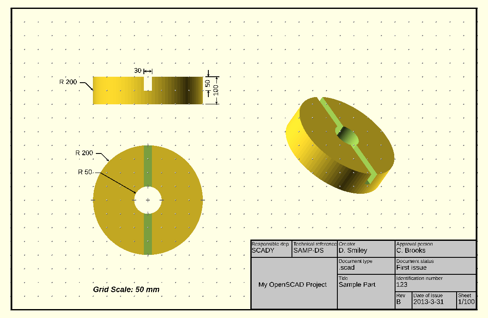

# DraftSCAD

DraftSCAD is an OpenSCAD library for dimensioned engineering drawings. It draws lines, arrows, dimensions, leader
lines, hole centre marks, sheet frames and title blocks, so a part modelled in OpenSCAD can be documented in OpenSCAD,
without exporting it to another CAD program to annotate it.



## Install

Clone the repository into your OpenSCAD library folder (**File → Show Library Folder** in OpenSCAD):

```sh
git clone https://github.com/CameronBrooks11/DraftSCAD.git
```

## Quick start

```scad
include <DraftSCAD/dimdraft.scad>

// a part
cube([ 4.5, 2, 0.2 ]);

// its length, drawn on a plane above it
translate([ 0, 2.4, 1 ]) dimensions(4.5);
```

Preview with F5, then set the view to Top and Orthogonal. [Getting started](docs/getting-started.md) continues from here.

## How it works

A drawing is an ordinary OpenSCAD scene looked at from directly above. Each view is the part placed on the XY plane in
the orientation that view needs, with its annotations as thin 3D shapes on a plane above it. With the camera looking
straight down in orthogonal projection, the scene reads as a flat drawing; nothing is projected or flattened. The
[docs home page](https://cameronbrooks11.github.io/DraftSCAD/) says more.

## What is in the library

| Module                                    | Draws                                                        |
| ----------------------------------------- | ------------------------------------------------------------ |
| `line`                                    | A line, with an optional arrow at either end                 |
| `arrow`                                   | One arrowhead                                                |
| `dimensions`                              | A dimension line, labelled with its length or with your text |
| `leader_line`                             | An angled arrow with a shoulder and a label                  |
| `circle_center`                           | Centre marks for a hole                                      |
| `draw_sheet`                              | A sheet frame with an optional dot or line grid              |
| `draw_frame`, `draw_grid`                 | The sheet frame or grid on its own                           |
| `titleblock`                              | A title block from lists of lines and text                   |
| `titleblock0`, `titleblock1`, `revblock0` | Ready-made title and revision blocks                         |

The [reference](docs/reference/index.md) has every parameter.

## Documentation

The documentation site is at <https://cameronbrooks11.github.io/DraftSCAD/>. The same pages are in `docs/`:

- [Getting started](docs/getting-started.md)
- [Workflow](docs/usage/workflow.md): how to lay out a part, its views and its sheet
- [Configuration](docs/usage/configuration.md): scale, line width and colour
- [Reference](docs/reference/index.md)
- [Examples](docs/examples/index.md), and the [example sources](examples/README.md)

## Contributing

Contributions are welcome. [CONTRIBUTING.md](CONTRIBUTING.md) covers the tools, `just check` and `just test`, the
fixtures and the docs.

## Acknowledgements

This repository builds upon the work of:

- Don Smiley from [Canny Machines](http://cannymachines.com/entries/9/openscad_dimensioned_drawings).
- pwpearson's enhancements on Canny Machines: [dimensional-drawings](https://github.com/pwpearson/dimensional-drawings).
