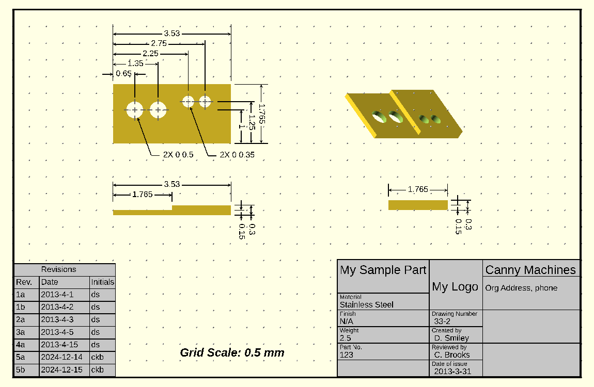
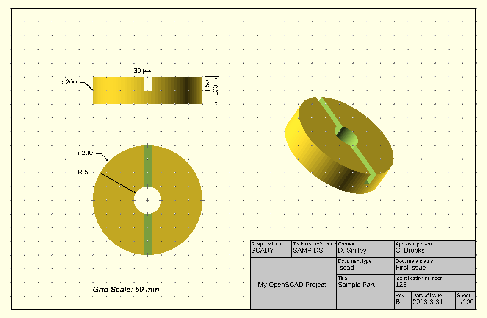

# DraftSCAD

OpenSCAD is an open-source program used to create 3D objects. Part of its appeal stems from its text-based input, which specifies the objects, placement, rotation, and other features. Unlike some other 3D programs, such as Blender, OpenSCAD provides precise, programmatic control over the characteristics of objects, enabling a streamlined design process without the need for manual adjustments on-screen.

However, creating manual machining equipment or workshop-ready parts often requires detailed, annotated engineering drawings—a capability that OpenSCAD does not natively provide. Furthermore, OpenSCAD's mesh-based output complicates the process of exporting designs to traditional CAD programs for annotation, even as a workaround. This limitation makes it challenging to bridge the gap between OpenSCAD's programmatic design strengths and the practical requirements of fabrication workflows. To address this, the utility library aims to enable the creation of dimensioned drawings directly within OpenSCAD, streamlining the process for designers who rely on this tool.



## Install

Clone the repository into your OpenSCAD library folder (**File → Show Library Folder** in OpenSCAD):

```sh
git clone https://github.com/CameronBrooks11/DraftSCAD.git
```

## Quick start

```scad
include <DraftSCAD/dimdraft.scad>

// a part
cube([ 4.5, 2, 0.2 ]);

// its length, drawn on a plane above it
translate([ 0, 2.4, 1 ]) dimensions(4.5);
```

Preview with F5, then set the view to Top and Orthogonal. [Getting started](docs/getting-started.md) continues from here.

## Approach

This library employs a top-down view in OpenSCAD, with dimensioned lines and text displayed on the XY plane. By combining multiple views of your object with projected and translated dimensioned lines, you can create the illusion of a complete dimensioned drawing.

A number of elements must come together to implement dimensioning:

- Lines, with or without arrows.
- Annotated dimensions and other textual descriptions.
- Support for common annotation conventions.

The library includes a partial implementation of these features, making it functional yet extensible for future improvements.

## What is in the library

| Module                                    | Draws                                           |
| ----------------------------------------- | ----------------------------------------------- |
| `line`                                    | A line, with an optional arrow at either end    |
| `dimensions`                              | A dimension line labelled with its length       |
| `leader_line`                             | An angled arrow with a shoulder and a label     |
| `circle_center`                           | Centre marks for a hole                         |
| `draw_sheet`                              | A sheet frame with an optional dot or line grid |
| `titleblock`                              | A title block from lists of lines and text      |
| `titleblock0`, `titleblock1`, `revblock0` | Ready-made title and revision blocks            |

The [reference](docs/reference/index.md) has every parameter.

## Documentation

- [Getting started](docs/getting-started.md)
- [Workflow](docs/usage/workflow.md): how to lay out a part, its views and its sheet
- [Configuration](docs/usage/configuration.md): scale, line width and colour
- [Reference](docs/reference/index.md)
- [Examples](docs/examples/index.md), and the [example sources](examples/README.md)

## Contributing

Contributions are welcome! Whether it's bug fixes, new features, or documentation improvements, your input helps make this project better. If you're interested in contributing, please check out the [open issues](https://github.com/CameronBrooks11/DraftSCAD/issues) for a list of development tasks and areas where help is needed. If you have suggestions or ideas that aren't listed, don't hesitate to open an issue to discuss them.

Run `just check` before opening a pull request. It evaluates every example with OpenSCAD and fails on any warning.

## Acknowledgements

This repository builds upon the work of:

- Don Smiley from [Canny Machines](http://cannymachines.com/entries/9/openscad_dimensioned_drawings).
- pwpearson's enhancements on Canny Machines: [dimensional-drawings](https://github.com/pwpearson/dimensional-drawings).
