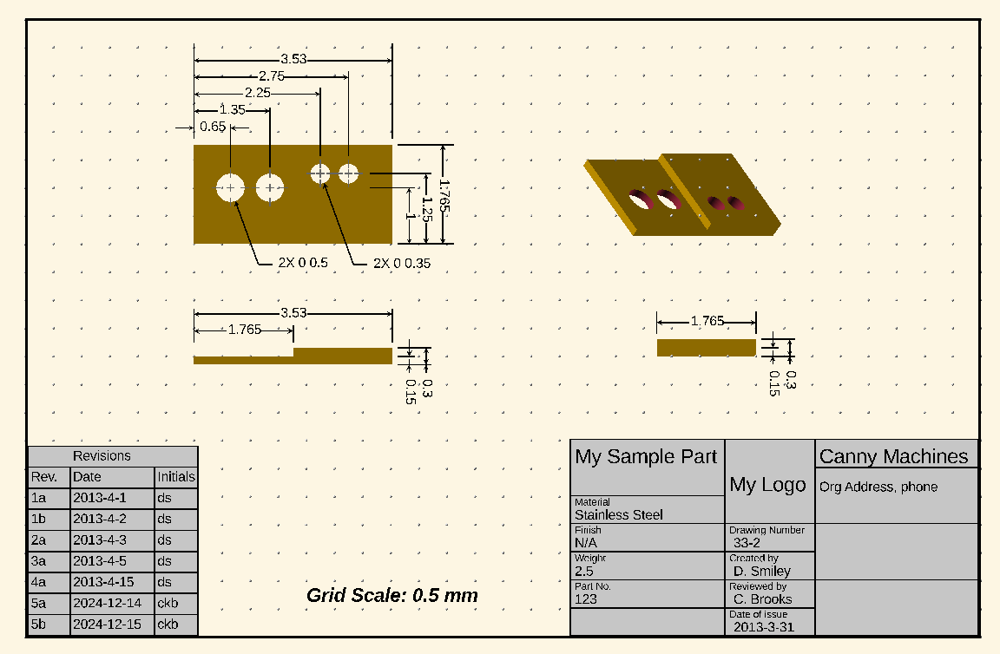
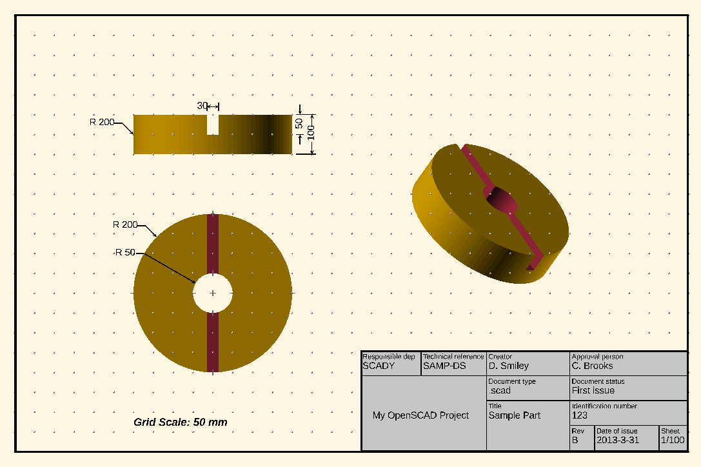

# Examples

The repository has three examples under
[`examples/`](https://github.com/CameronBrooks11/DraftSCAD/tree/main/examples). Open the file named below in
OpenSCAD, preview with F5, and set the view to Top and Orthogonal.

## Simple usage

[`examples/usageSimple/usage_samples.scad`](https://github.com/CameronBrooks11/DraftSCAD/blob/main/examples/usageSimple/usage_samples.scad)

One file that draws each basic element: lines, the four dimension label positions, hole centre marks and leader
lines. Start here to see what each module produces.

## Canny Machines

[`examples/cannymachines/example_CM.scad`](https://github.com/CameronBrooks11/DraftSCAD/blob/main/examples/cannymachines/example_CM.scad)

A stepped plate with four holes, drawn at the default scale. It shows:

- three dimensioned views and one undimensioned pictorial view, each in its own file
- stacked dimensions with extension lines
- leader lines for the hole sizes
- `titleblock0` and `revblock0`
- a dot grid on a 17 × 11 sheet

## Don Smiley

[`examples/donsmiley/example_DS.scad`](https://github.com/CameronBrooks11/DraftSCAD/blob/main/examples/donsmiley/example_DS.scad)

A slotted disc 400 units across, drawn with `SCALING_FACTOR = 100`. It shows:

- how a large part needs a large scale; see [Configuration](../usage/configuration.md)
- vertical dimensions made by rotating `dimensions()`
- leader lines for radii
- `titleblock1`

Some labels in this drawing touch their arrows and each other. That is
[#2](https://github.com/CameronBrooks11/DraftSCAD/issues/2).

Both sheet examples follow the file layout described in [Workflow](../usage/workflow.md).
