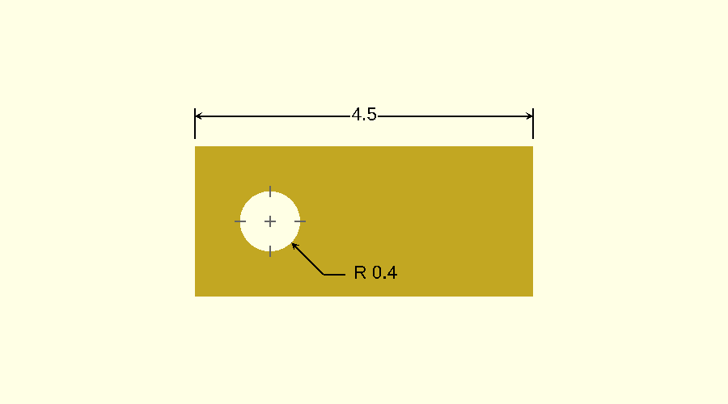

# Getting started

## Install

Clone the repository into your OpenSCAD library folder. In OpenSCAD, **File → Show Library Folder** opens it.

```sh
git clone https://github.com/CameronBrooks11/DraftSCAD.git
```

You can also clone it next to your project and include it by relative path.

DraftSCAD is developed against OpenSCAD 2026.10.15. Older releases are not tested.

## Include the library

```scad
include <DraftSCAD/dimdraft.scad>
```

Use `include`, not `use`. The library's constants, such as `DIM_LEFT` and `DIM_SPACE`, are top-level variables, and
`use` does not bring those into your file.

The title block templates are a second file:

```scad
include <DraftSCAD/ddtemplates.scad>
```

## A first drawing

This models a plate with one hole and dimensions it.

```scad
include <DraftSCAD/dimdraft.scad>

plate = [ 4.5, 2, 0.2 ];
hole_pos = [ 1, 1 ];
hole_r = 0.4;

// the part
difference()
{
    cube(plate);
    translate([ hole_pos[0], hole_pos[1], -1 ]) cylinder(h = 2, r = hole_r, $fn = 64);
}

// the annotations, on a plane above the part
translate([ 0, 0, 1 ])
{
    // overall length, with an extension line at each end
    translate([ 0, plate[1] + DIM_SPACE * 4, 0 ]) dimensions(plate[0]);
    translate([ 0, plate[1] + DIM_SPACE, 0 ]) line(length = DIM_SPACE * 4, vert = true);
    translate([ plate[0], plate[1] + DIM_SPACE, 0 ]) line(length = DIM_SPACE * 4, vert = true);

    // the hole: centre marks and a leader with its radius
    translate([ hole_pos[0], hole_pos[1], 0 ])
    {
        circle_center(radius = hole_r);
        leader_line(angle = -45, radius = hole_r, angle_length = 0.6, horz_length = 0.3, text = str("R ", hole_r));
    }
}
```



Three things to notice:

- The annotations are translated up by 1, above the top of the part. From the top they overlay it.
- Positions are written in multiples of `DIM_SPACE`, the library's spacing unit, so they follow the drawing scale.
- `dimensions()` prints the length it is given. The label is always `str(length)`.

## View it

1. Preview with **F5**. Do not render with F6: the text disappears.
2. **View → Top**.
3. **View → Orthogonal**.

## Export the drawing

In the application, **File → Export → Export as Image** saves the preview.

From the command line, this is the command that produced the image above:

```sh
openscad -o drawing.png --camera=0,0,0,0,0,0,0 --viewall --autocenter --projection=o --imgsize=900,500 drawing.scad
```

`--camera=0,0,0,0,0,0,0` looks straight down, `--projection=o` is orthogonal, and `--viewall --autocenter` fit the
scene to the image.

There is no vector output. SVG, DXF and PDF export need a 2D scene, and a DraftSCAD drawing is 3D.

## Scale

The default line width and text size suit a part a few units across, like the plate above. For a part hundreds of
units across the annotations would be too small to see. Set `SCALING_FACTOR` before the include:

```scad
SCALING_FACTOR = 100;
include <DraftSCAD/dimdraft.scad>
```

[Configuration](usage/configuration.md) covers this and the other settings.
