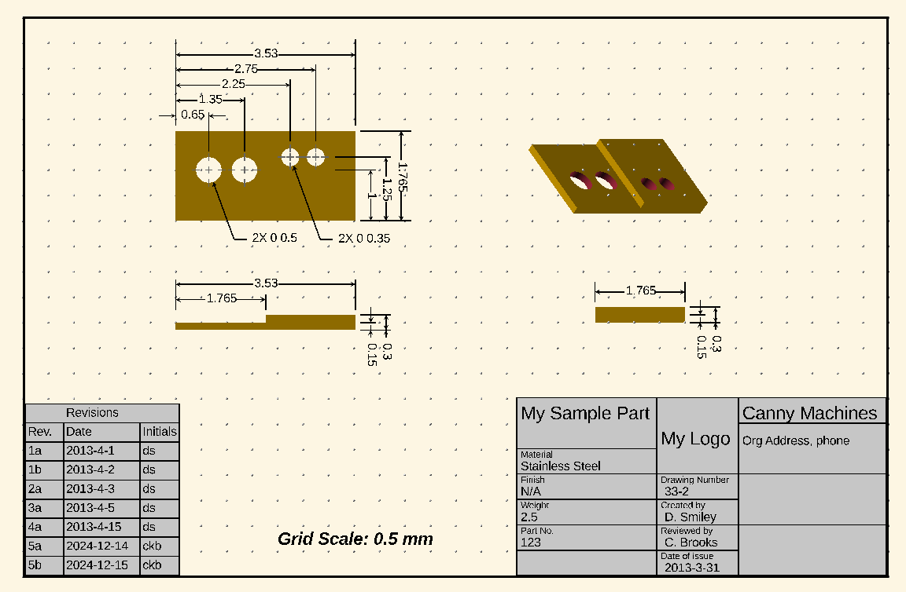

# DraftSCAD

DraftSCAD is an OpenSCAD library for dimensioned engineering drawings. It draws lines, arrows, dimensions, leader
lines, hole centre marks, sheet frames and title blocks, so a part modelled in OpenSCAD can be documented in OpenSCAD.

## How it works

A DraftSCAD drawing is an ordinary OpenSCAD scene looked at from directly above.

- The part sits on the XY plane, once per view, rotated to show the face that view needs.
- The annotations are thin 3D shapes on a plane above the part, so they are never hidden by it.
- With the camera looking straight down in orthogonal projection, the scene reads as a flat drawing.

Rotate the camera and the illusion breaks: the annotations float above the parts. Nothing is projected or flattened.

The drawing is the preview (F5). A full render (F6) does not work, because the library mixes 2D text with 3D lines and
OpenSCAD drops the text. Export the preview as an image; see [Getting started](getting-started.md#export-the-drawing).

## Where to go next

- [Getting started](getting-started.md) installs the library and dimensions a first part.
- [Usage](usage/index.md) covers the file layout for a real drawing and how to scale the annotations to the part.
- [Reference](reference/index.md) lists every module, its parameters and its known issues.
- [Examples](examples/index.md) walks through the three example drawings in the repository.

## Acknowledgements

DraftSCAD builds on the work of:

- Don Smiley, from [Canny Machines](http://cannymachines.com/entries/9/openscad_dimensioned_drawings).
- pwpearson's enhancements to it: [dimensional-drawings](https://github.com/pwpearson/dimensional-drawings).
