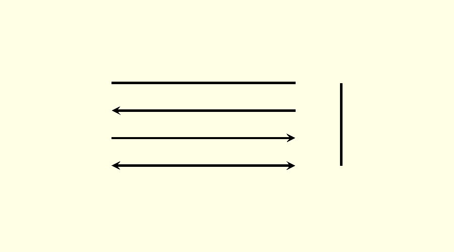
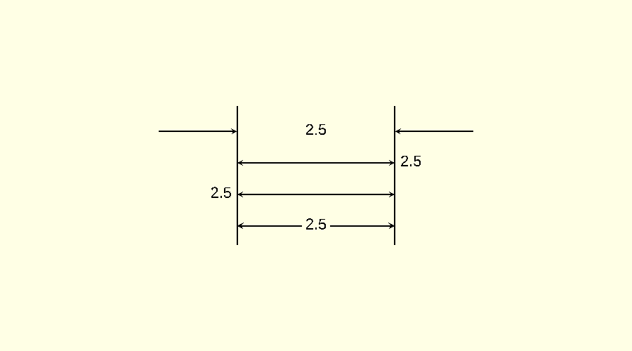
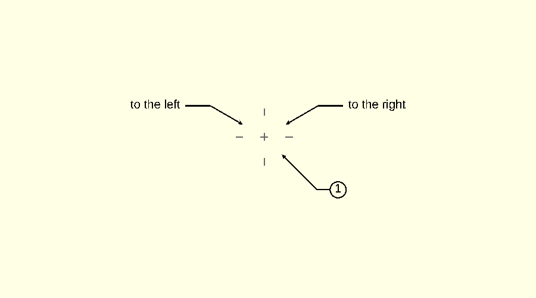
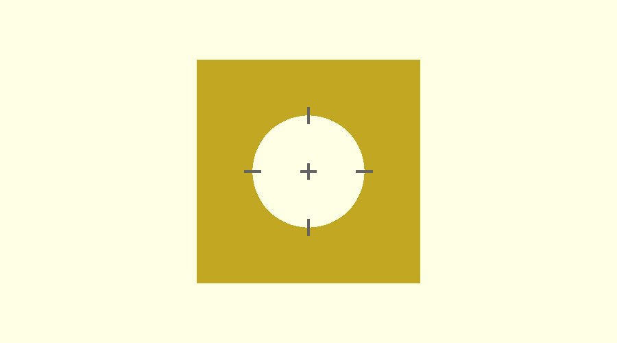

# Lines and dimensions

Defined in `src/dd_dimlines.scad`.

## line

```scad
line(length, width = DIM_LINE_WIDTH, height = DIM_LINE_HEIGHT, left_arrow = false, right_arrow = false,
     vert = false, color = DEF_LINE_COLOR)
```

Draws a straight line from the origin along +X, with an optional arrowhead at either end.

| Parameter     | Meaning                                                    |
| ------------- | ---------------------------------------------------------- |
| `length`      | Total length, arrowheads included                          |
| `width`       | Line width                                                 |
| `height`      | Z thickness                                                |
| `left_arrow`  | Arrowhead at the origin end                                |
| `right_arrow` | Arrowhead at the far end                                   |
| `vert`        | Draw along +Y instead of +X                                |
| `color`       | Line colour                                                |

The line starts at the origin and is centred on its axis across its width. That makes a line easy to place by its
start point, and lets two lines meet at a corner without a half-width correction.

An arrowhead is 4 line widths across.

```scad
include <DraftSCAD/dimdraft.scad>

line(length = 2);
translate([ 0, -0.3, 0 ]) line(length = 2, left_arrow = true);
translate([ 0, -0.6, 0 ]) line(length = 2, right_arrow = true);
translate([ 0, -0.9, 0 ]) line(length = 2, left_arrow = true, right_arrow = true);
translate([ 2.5, -0.9, 0 ]) line(length = 0.9, vert = true);
```



## arrow

```scad
arrow(arr_points, arr_length, height, color = DEF_LINE_COLOR)
```

Draws one arrowhead with its tip at the origin, pointing toward −X. `line()` uses it; you rarely need it directly.

| Parameter    | Meaning                                                   |
| ------------ | --------------------------------------------------------- |
| `arr_points` | Width across the barbs, and the distance from tip to barbs |
| `arr_length` | Distance from the tip to the notch at the back of the head |
| `height`     | Z thickness                                               |

## dimensions

```scad
dimensions(length, line_width = DIM_LINE_WIDTH, line_height = DIM_LINE_HEIGHT, loc = DIM_CENTER,
           color = DEF_LINE_COLOR, text_color = DEF_TEXT_COLOR)
```

Draws a dimension line from the origin along +X, `length` long, labelled with `length`.

| Parameter | Meaning                                         |
| --------- | ----------------------------------------------- |
| `length`  | The distance to dimension, and the label        |
| `loc`     | Where the label goes; see below                 |

| `loc`         | Result                                                                        |
| ------------- | ----------------------------------------------------------------------------- |
| `DIM_CENTER`  | Arrows point outward to both ends, with the label in a gap in the middle      |
| `DIM_LEFT`    | One unbroken line with an arrow at each end, label to the left                |
| `DIM_RIGHT`   | One unbroken line with an arrow at each end, label to the right               |
| `DIM_OUTSIDE` | Two arrows outside the distance pointing inward, label between them           |

Use `DIM_LEFT`, `DIM_RIGHT` or `DIM_OUTSIDE` when the distance is too short to hold the label.

If you do not, the module handles it. A `DIM_CENTER` dimension with no room for its label and two arrows is drawn in
the `DIM_OUTSIDE` form. If the label does not fit between the arrows either, it goes to the right of them.

```scad
include <DraftSCAD/dimdraft.scad>

length = 2.5;

// two vertical lines to mark the distance being dimensioned
line(length = 2.2, vert = true);
translate([ length, 0, 0 ]) line(length = 2.2, vert = true);

locs = [ DIM_CENTER, DIM_LEFT, DIM_RIGHT, DIM_OUTSIDE ];
for (i = [0:3])
    translate([ 0, 0.3 + 0.5 * i, 0 ]) dimensions(length, loc = locs[i]);
```



Things to know:

- The label is always `str(length)`. There is no way to add a prefix, a tolerance or units, or to set the precision.
- A dimension is always horizontal. For a vertical one, wrap it in `rotate([ 0, 0, 90 ])`; the label rotates with it.
- The module does not draw extension lines. Draw those with `line()`.
- The room a label needs comes from `dd_text_units()`, an estimate that is exact for numbers in the default font.

## dd_text_units

```scad
dd_text_units(text)
```

A function. It estimates the width of a string in font units, at OpenSCAD's default text size of 10. Multiply by
`DIM_FONTSCALE` for the width as drawn.

It counts 7.724 for every character except a period or a space, which count 3.859. Those are the advances of the
digits, the period and the space in the default font, so the result is exact for a number: `dd_text_units("3.53")`
is 27.031. It is only approximate for letters, which vary in width, and for any other font.

The library estimates the width and does not call `textmetrics()`, so it needs nothing newer than OpenSCAD 2021.01.

## leader_line

```scad
leader_line(angle, radius, angle_length, horz_length, direction = DIM_RIGHT, line_width = DIM_LINE_WIDTH,
            line_height = DIM_LINE_HEIGHT, text = "", do_circle = false, color = DEF_LINE_COLOR,
            text_color = DEF_TEXT_COLOR)
```

Draws an arrow pointing at the origin from a given angle, a horizontal shoulder, and a label.

| Parameter      | Meaning                                                                      |
| -------------- | ---------------------------------------------------------------------------- |
| `angle`        | Direction of the angled segment, in degrees from +X                          |
| `radius`       | Distance from the origin to the arrow tip                                    |
| `angle_length` | Length of the angled segment                                                 |
| `horz_length`  | Length of the horizontal shoulder                                            |
| `direction`    | `DIM_RIGHT` or `DIM_LEFT`: which way the shoulder and label extend           |
| `text`         | The label; leave it out to draw the line alone                               |
| `do_circle`    | Draw a circle around the label, for a balloon number                         |

Translate to the centre of the feature first. To point at the rim of a hole, pass the hole's radius as `radius`. To
point at a spot, pass `radius = 0`.

```scad
include <DraftSCAD/dimdraft.scad>

radius = 0.5;
circle_center(radius);

leader_line(angle = 30, radius = radius, angle_length = 0.75, horz_length = 0.5, text = "to the right");
leader_line(angle = 150, radius = radius, angle_length = 0.75, horz_length = 0.5, direction = DIM_LEFT,
            text = "to the left");
leader_line(angle = -45, radius = radius, angle_length = 1, horz_length = 0.25, text = "1", do_circle = true);
```



The circle is centred on the label and its edge meets the end of the shoulder line. Its size comes from
`dd_text_units()`, so it fits a number; a label of letters may sit off-centre in it.

## circle_center

```scad
circle_center(radius, size = DIM_HOLE_CENTER, line_width = DIM_LINE_WIDTH, line_height = DIM_LINE_HEIGHT,
              color = "grey")
```

Marks the centre of a circle at the origin: a cross at the centre, and a short tick across the circle on each axis.

| Parameter | Meaning                                |
| --------- | -------------------------------------- |
| `radius`  | Radius of the circle being marked      |
| `size`    | Length of each mark                    |

```scad
include <DraftSCAD/dimdraft.scad>

radius = 0.5;

difference()
{
    cube([ 2, 2, 1 ], center = true);
    cylinder(h = 2, r = radius, center = true, $fn = 100);
}

// drawn just above the top face
translate([ 0, 0, 0.5 ]) circle_center(radius);
```



The module does not draw centre lines across the part. Add those with `line()` if you want them.
