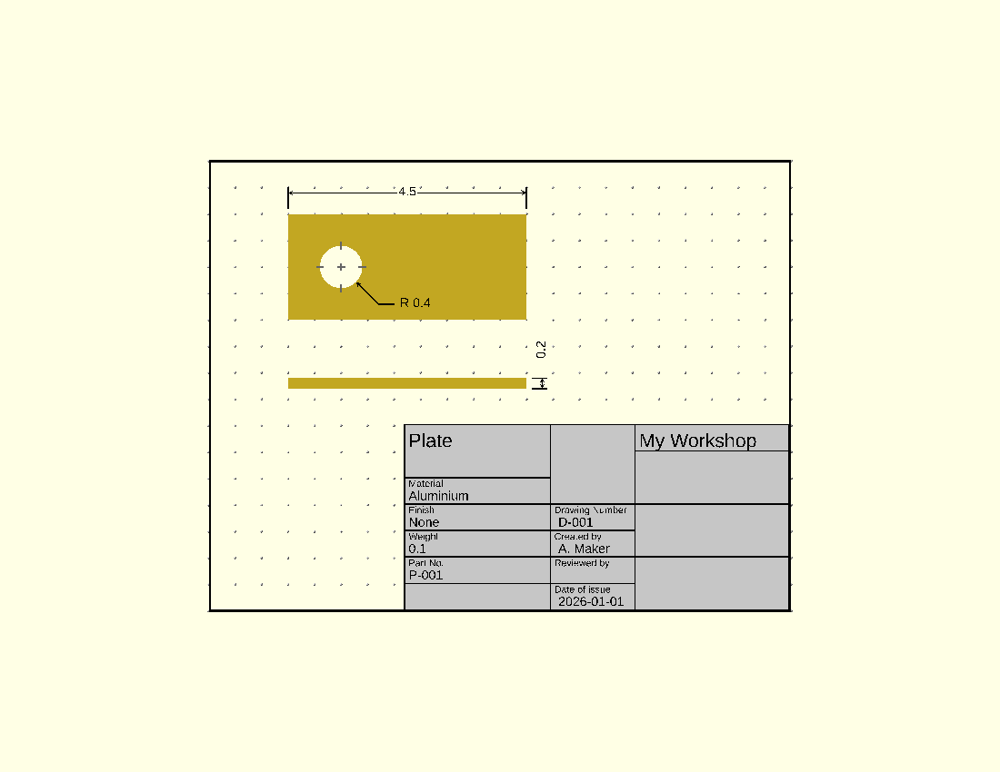

# Workflow

A single file is enough for one view of one part. A real drawing has several views on a sheet with a title block,
and it is easier to manage as four kinds of file. This is the layout the examples in the repository use.

| File          | Holds                                                                  |
| ------------- | ---------------------------------------------------------------------- |
| Config        | The drawing settings: `SCALING_FACTOR`, colours, the annotation height |
| Part          | The part's dimensions as top-level variables, and the module for it    |
| One per view  | The part in one orientation, with that view's annotations              |
| Sheet         | The views placed on a sheet, with the frame and title block            |

The rest of this page builds a small drawing that way.

## Config

```scad
// file: config.scad
DOC_HEIGHT = 3;
```

`DOC_HEIGHT` is your own variable, not the library's. It is the height the annotations sit at, and it has to clear
the tallest part in any view. Library settings such as `SCALING_FACTOR` go here too; see
[Configuration](configuration.md).

## Part

```scad
// file: part.scad
plate_length = 4.5;
plate_width = 2;
plate_thickness = 0.2;
hole_x = 1;
hole_y = 1;
hole_r = 0.4;

module plate()
{
    difference()
    {
        cube([ plate_length, plate_width, plate_thickness ]);
        translate([ hole_x, hole_y, -1 ]) cylinder(h = 2, r = hole_r, $fn = 64);
    }
}
```

Keep every dimension as a named top-level variable. The view files read the same variables, so a dimension on the
drawing cannot disagree with the part.

## Views

```scad
// file: view_top.scad
include <config.scad>
include <DraftSCAD/dimdraft.scad>
include <part.scad>

module view_top()
{
    plate();

    translate([ 0, 0, DOC_HEIGHT ])
    {
        translate([ 0, plate_width + DIM_SPACE * 4, 0 ]) dimensions(plate_length);
        translate([ 0, plate_width + DIM_SPACE, 0 ]) line(length = DIM_SPACE * 4, vert = true);
        translate([ plate_length, plate_width + DIM_SPACE, 0 ]) line(length = DIM_SPACE * 4, vert = true);

        translate([ hole_x, hole_y, 0 ])
        {
            circle_center(radius = hole_r);
            leader_line(angle = -45, radius = hole_r, angle_length = 0.6, horz_length = 0.3, text = str("R ", hole_r));
        }
    }
}

view_top();
```

```scad
// file: view_front.scad
include <config.scad>
include <DraftSCAD/dimdraft.scad>
include <part.scad>

module view_front()
{
    // stand the plate on its long edge so the camera sees the front face
    translate([ 0, plate_thickness, 0 ]) rotate([ 90, 0, 0 ]) plate();

    translate([ 0, 0, DOC_HEIGHT ])
    {
        // thickness, drawn to the right of the view
        translate([ plate_length + DIM_SPACE * 3, 0, 0 ]) rotate([ 0, 0, 90 ])
            dimensions(plate_thickness, loc = DIM_RIGHT);
        translate([ plate_length + DIM_SPACE, 0, 0 ]) line(length = DIM_SPACE * 3);
        translate([ plate_length + DIM_SPACE, plate_thickness, 0 ]) line(length = DIM_SPACE * 3);
    }
}

view_front();
```

Each view file includes the config, the library and the part, in that order, and ends by calling its own module. That
last line means you can open a view file on its own and work on it.

The config comes first because the library reads its settings when it is included.

A dimension is always drawn along X. For a vertical one, rotate it, as `view_front` does.

## Sheet

```scad
// file: sheet.scad
include <config.scad>
include <DraftSCAD/ddtemplates.scad>
include <DraftSCAD/dimdraft.scad>

use <view_top.scad>
use <view_front.scad>

translate([ 1.5, 5.5, 0 ]) view_top();
translate([ 1.5, 4.2, 0 ]) view_front();

// the frame and grid sit just below the views
translate([ 0, 0, -DIM_LINE_WIDTH ]) draw_sheet(length = 11, height = 8.5, grid_type = "Dot", grid_dim = 0.5);

part_details = [ "Plate", "Aluminium", "None", "0.1", "P-001" ];
doc_details = [ "D-001", "A. Maker", "", "2026-01-01" ];
org_details = [ "", "My Workshop", "" ];
translate([ 3.7, 3.52, 0 ]) titleblock0(part_details, doc_details, org_details);
```



The sheet brings the views in with `use`, not `include`. `use` makes the module available without running the
`view_top();` call at the bottom of the view file, so each view appears once, where the sheet puts it.

The title block is placed by hand. Its origin is its top-left corner; see [Title blocks](../reference/title-blocks.md)
for its size.

## Sharing dimensions between parts

When two parts must agree on a dimension, such as a shaft and the hole it goes through, put that dimension in a file
both parts include. Keep dimensions that belong to one part in that part's file.

OpenSCAD has one namespace for top-level variables in included files, so give each a distinct name. Two included
part files that both define `length` will silently share the last value assigned.
